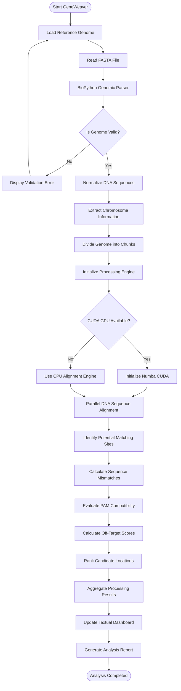
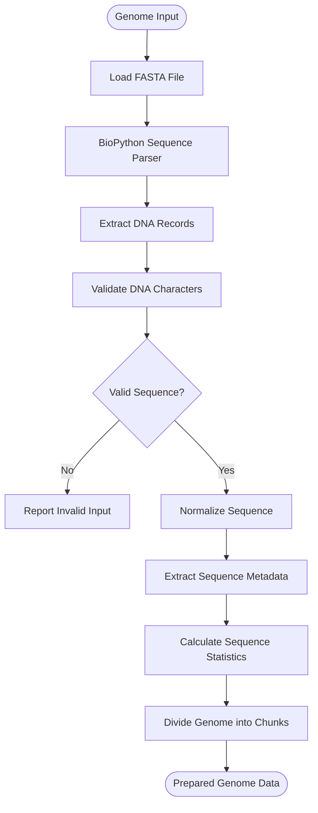
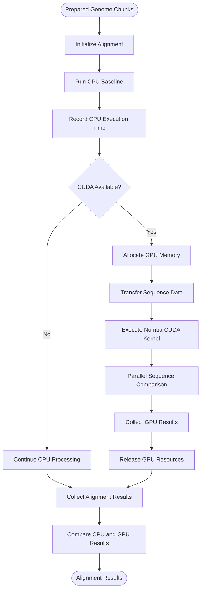
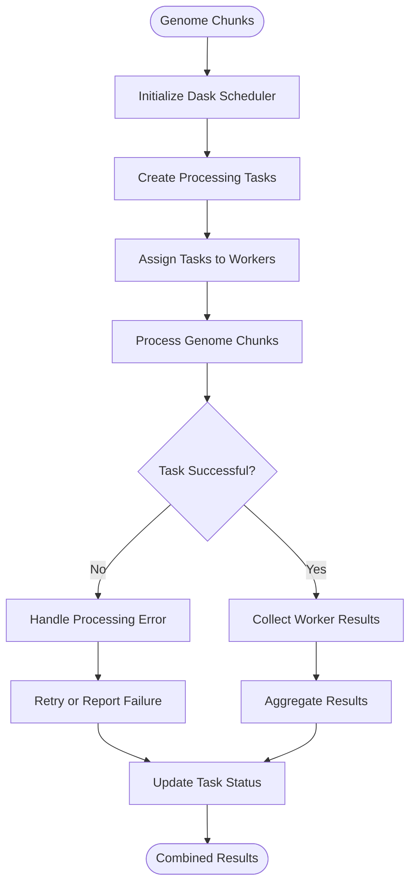
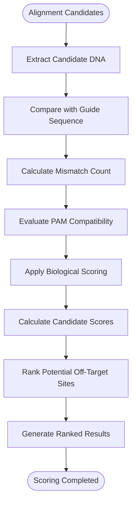
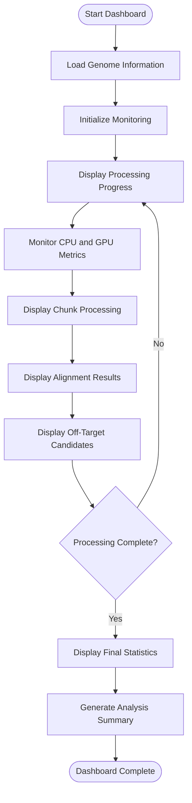
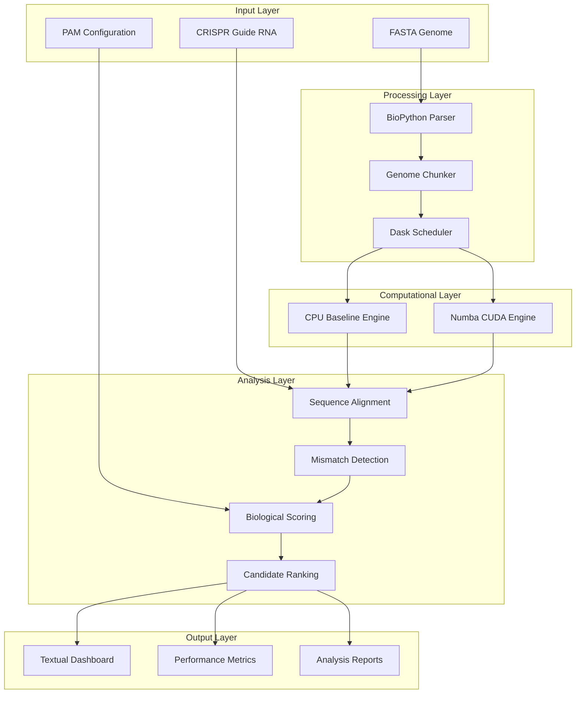

# 🧬 GeneWeaver – System Flowchart

## 1. Project Workflow Overview

GeneWeaver is a GPU-Accelerated CRISPR Alignment Engine designed to identify potential CRISPR off-target sites in genomic DNA sequences.

The system follows a structured pipeline consisting of genomic input, sequence parsing, validation, genome chunking, CPU/GPU alignment, distributed processing, biological scoring, and result visualization.

## 2. Main System Flowchart

## 3. Detailed Module Flowcharts

### Module 1 – Genomic Parser

Responsible for reading, validating, and preparing genomic FASTA data.

### Module 2 – CUDA Alignment Engine

Responsible for sequence comparison and GPU acceleration.

### Module 3 – Distributed Scheduler

Responsible for distributing genomic chunks and collecting processing results.

### Module 4 – Off-Target Scoring Engine

Responsible for evaluating potential CRISPR off-target matches.

### Module 5 – Live Textual Dashboard

Responsible for presenting processing information and analysis results.

## 4. Data Processing Pipeline

| Stage | Module | Responsibility |
|---|---|---|
| 1 | Input | Load reference genome and guide RNA |
| 2 | Parser | Parse FASTA records |
| 3 | Validation | Verify DNA sequence integrity |
| 4 | Chunking | Divide genome into manageable sections |
| 5 | Alignment | Compare genomic sequences |
| 6 | Acceleration | Execute supported GPU computation |
| 7 | Scheduling | Manage parallel processing tasks |
| 8 | Scoring | Evaluate mismatches and PAM compatibility |
| 9 | Ranking | Rank potential off-target candidates |
| 10 | Dashboard | Display processing and analysis results |
| 11 | Reporting | Generate structured analysis reports |

## 5. System Architecture

## 6. Expected System Outputs

The completed application is intended to provide:

- Genome processing statistics.
- FASTA validation results.
- Chromosome and sequence information.
- CPU and GPU execution benchmarks.
- Genome chunk-processing progress.
- Potential CRISPR off-target locations.
- Sequence mismatch counts.
- PAM compatibility information.
- Ranked candidate results.
- Performance summaries.
- Structured analysis reports.

## 7. Development Roadmap

| Development Phase | Main Deliverable |
|---|---|
| Week 1 | FASTA parser, CPU baseline and genome chunking |
| Week 2 | CUDA alignment engine and Textual dashboard |
| Mid-Project Review | Performance benchmarking and memory validation |
| Week 3 | Dask integration and biological scoring |
| Week 4 | CUDA optimization, dashboard refinement and final testing |

## 8. Important Implementation Notes

- CPU and GPU execution must be independently identifiable.
- GPU acceleration must only be reported when CUDA kernels actually execute.
- Dask task scheduling must not be confused with GPU acceleration.
- Sequence alignment and biological scoring must use documented algorithms.
- Processing errors and invalid genomic input must be handled safely.
- Performance metrics must come from actual measurements.
- Potential off-target matches are computational predictions, not experimentally confirmed mutations.

---

**GeneWeaver – Accelerating Genomic Analysis Through High-Performance Python Computing.**
